# ens-checker

ens-checker lee un fichero de hechos `clave: valor` de un sistema (categoría, longitud de contraseña, MFA de administradores, retención de logs, antigüedad de parches, cifrado de disco, versión de TLS, frecuencia de copias, cuentas de administración compartidas, fecha del último análisis de riesgos, registro de incidentes, sincronización horaria) y lo compara con los umbrales de referencia del Esquema Nacional de Seguridad (Real Decreto 311/2022) para la categoría declarada. Cada hallazgo indica la medida del ENS con la que se relaciona.



**Demo en vivo:** https://jvch0512.github.io/ens-checker/ (datos sintéticos)

## Uso

```bash
make build
build/ens-checker examples
build/ens-checker sistema.facts --tsv
build/ens-checker sistema.facts --fail-on high
```

Códigos de salida: 0 correcto, 1 hallazgos iguales o superiores a `--fail-on`, 2 entrada no válida. La salida es texto por defecto y TSV con `--tsv`; también hay SARIF mediante `scripts/tsv2sarif.py`.

| Regla | Severidad | Qué detecta |
|---|---|---|
| ENS001 | media | longitud mínima de contraseña inferior a 8 (BÁSICA), 12 (MEDIA) o 14 (ALTA), medida op.acc.6 |
| ENS002 | media o alta | sin MFA para administradores: media en BÁSICA, alta en MEDIA y ALTA, op.acc.6 R8 |
| ENS003 | media | retención de logs inferior a 90 días (BÁSICA), 180 (MEDIA) o 365 (ALTA), op.exp.8 R3 |
| ENS004 | media | parche pendiente más antiguo de 90 días (BÁSICA), 30 (MEDIA) o 15 (ALTA), op.exp.4 |
| ENS005 | alta | sin cifrado de disco en MEDIA y ALTA, mp.si.2 |
| ENS006 | alta | versión mínima de TLS inferior a 1.2, mp.com.2 y mp.com.3 |
| ENS007 | media | intervalo de copias superior a 7 días (BÁSICA) o 1 día (MEDIA, ALTA), mp.info.6 |
| ENS008 | alta | cuentas de administración compartidas, op.acc.1 |
| ENS009 | media | análisis de riesgos ausente o de más de 12 meses, op.pl.1 |
| ENS010 | media | sin registro de incidentes en MEDIA y ALTA, op.exp.7 |
| ENS011 | baja | relojes no sincronizados, op.exp.8 R2 |
| ENS000 | info | fichero vacío o sin categoría declarada (se asume MEDIA) |

## Límites

- Comprueba lo que declara el fichero de hechos. No accede a los sistemas ni verifica los datos.
- Los umbrales son valores de referencia prudentes para revisión, no cifras escritas en el Real Decreto. Por ejemplo, op.exp.8 R3 solo exige documentar el tiempo de retención, y las reglas de contraseñas proceden de op.acc.6 y las guías CCN-STIC, así que prevalece su guía interna.
- Los identificadores de medidas siguen el Anexo II del Real Decreto 311/2022, contrastado con el texto del BOE.
- Un dato ausente se informa como no declarado.
- Es una ayuda de preparación, no una certificación.

## Dónde encaja

Preparar un sistema para una evaluación de conformidad con el ENS, o revisar de antemano el cuestionario de un proveedor para un cliente del sector público.

## Pruebas

```bash
make test
```

## Más información

- Código abierto bajo licencia MIT. Seguridad: [SECURITY.md](SECURITY.md).
- Validación con datos reales: [docs/validation.md](docs/validation.md) (en inglés).
- Versión en inglés: [README.md](README.md).
