# ens-checker

[Español](README.es.md)

ens-checker reads a small `key: value` facts file for one system (category, password length, MFA for administrators, log retention, patch age, disk encryption, TLS version, backup frequency, shared admin accounts, date of the last risk analysis, incident register, time sync) and compares it with the thresholds the Spanish Esquema Nacional de Seguridad (Real Decreto 311/2022) expects for the declared category. Each finding names the ENS measure it relates to.



**Live demo:** https://jvch0512.github.io/ens-checker/ (Synthetic data.)

Chicken Scheme 5 (csc), core libraries only. The demo page is rendered from the tool's `--tsv` output by `scripts/site.py` (Python 3, only needed to regenerate the page).

## Use

```bash
make build
build/ens-checker examples
build/ens-checker system.facts --tsv
build/ens-checker system.facts --fail-on high       # exit 1 on any high finding
```

Exit codes: 0 ok, 1 findings at or above `--fail-on`, 2 bad input. Output is human text by default and TSV with `--tsv` (`# N files, M findings`, then `SEVERITY<TAB>RULE<TAB>WHERE<TAB>MESSAGE`).

| Rule | Severity | What it catches |
|---|---|---|
| ENS001 | medium | password minimum length below 8 (BASICA), 12 (MEDIA) or 14 (ALTA), measure op.acc.6 |
| ENS002 | medium or high | no MFA for administrators: medium in BASICA, high in MEDIA and ALTA, op.acc.6 R8 |
| ENS003 | medium | log retention below 90 days (BASICA), 180 (MEDIA) or 365 (ALTA), op.exp.8 R3 |
| ENS004 | medium | oldest unapplied patch older than 90 days (BASICA), 30 (MEDIA) or 15 (ALTA), op.exp.4 |
| ENS005 | high | no disk encryption in MEDIA and ALTA, mp.si.2 |
| ENS006 | high | minimum TLS version below 1.2, mp.com.2 and mp.com.3 |
| ENS007 | medium | backup interval above 7 days (BASICA) or 1 day (MEDIA, ALTA), mp.info.6 |
| ENS008 | high | shared administrator accounts, op.acc.1 |
| ENS009 | medium | risk analysis missing or older than 12 months, op.pl.1 |
| ENS010 | medium | no incident register in MEDIA and ALTA, op.exp.7 |
| ENS011 | low | clocks not synchronised, op.exp.8 R2 |
| ENS000 | info | empty file, or no category declared (MEDIA is assumed) |

See [examples](examples) and [docs/sample-output.txt](docs/sample-output.txt).

## Limits

- It checks what the facts file states. It does not log in to systems or verify the facts.
- Thresholds are conservative reference values chosen for review, not numbers written in the Real Decreto. For example, op.exp.8 R3 only requires the retention time to be documented, and password rules come from op.acc.6 and the CCN-STIC guides, so your own guide wins.
- Measure identifiers follow Annex II of Real Decreto 311/2022 (checked against the BOE text).
- A missing fact is reported as not declared.
- The file format is one `key: value` per line with `#` comments. Keys are listed in the examples.
- This is a preparation aid, not a certification.

## Where it fits

Preparing a system for an ENS conformity assessment, or pre-checking a supplier questionnaire for a public-sector customer in Spain.

## Tests

```bash
make test    # A Scheme test program: every rule at every category threshold, dates, hostile input, 3000-case fuzzing and CLI exit codes
```

MIT.

## Code scanning (SARIF)

`scripts/tsv2sarif.py` converts the `--tsv` output into SARIF 2.1.0, so findings show up in GitHub code scanning:

```sh
build/ens-checker examples --today 2026-11-16 --tsv | python3 scripts/tsv2sarif.py --tool ens-checker --prefix examples > results.sarif
```

Upload `results.sarif` with `github/codeql-action/upload-sarif`. Severities map to SARIF levels (critical and high to error, medium to warning, low and info to note) and to a `security-severity` score.

## Validated on real data

This tool was run on public corpora and the false positives it produced were fixed. Corpus, counts and bugs found are in [docs/validation.md](docs/validation.md).
